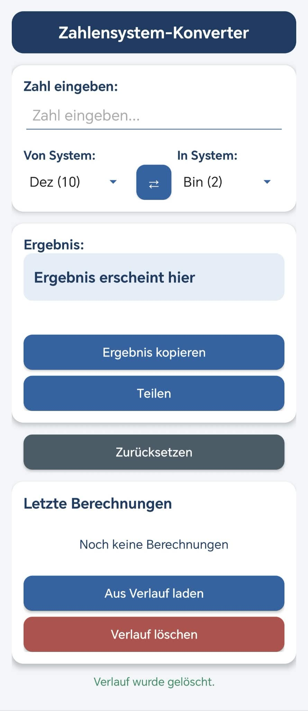
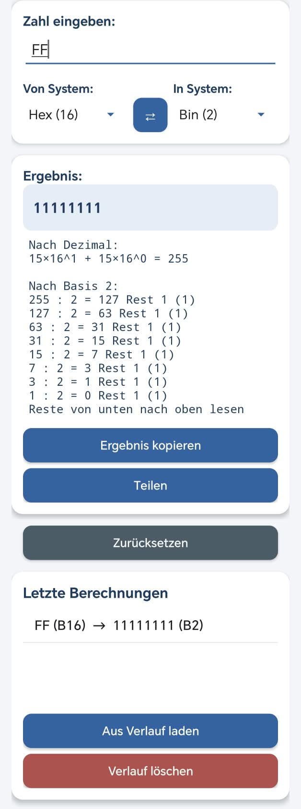
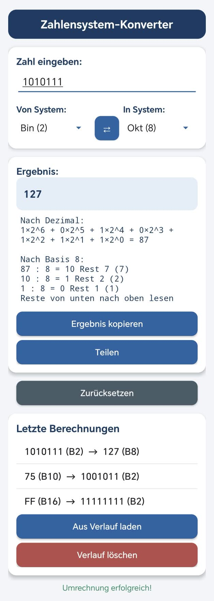

# BaseConvert

[Deutsche Version](README.md)

BaseConvert is an Android app that converts numbers between decimal, binary, octal and hexadecimal and shows the solution step by step. It is designed for school and university students.

## How it was built

The idea, the layout, the decisions about the features and all the testing are mine. I developed the code with the support of an AI assistant, and I pasted it into Android Studio, tested it and adjusted it myself.

## Features

- **Live conversion:** The result appears while you type. Thanks to BigInteger, very large numbers work too.
- **Step-by-step solution:** The app shows the intermediate steps: the place-value expansion (to decimal) and the repeated division with remainders (to the target system).
- **Input validation:** Digits that are invalid for the selected system are detected. Letters from A to F are capitalized automatically.
- **History:** Pressing the Enter key saves a calculation. The history is kept after the app is closed, and an entry can be loaded again. Consecutive duplicates are avoided.
- **Copy and share:** You can copy the result or share it together with the solution steps via other apps, for example Word, notes or messengers.
- **Swap and dark mode:** You can swap the source and target systems with one tap. The design follows the device's light and dark mode.

## Screenshots

  
  
  

## How it works

1. The input is checked: only digits and letters that are valid in the selected system are accepted.
2. The text is converted into a number value with BigInteger and then output again in the target system.
3. Pressing the Enter key saves the calculation in the history, which is kept even after the app is closed.

## Built with

- Java
- Android Studio
- XML layouts (card design with rounded corners)
- Standard Android SDK classes, no external libraries

## Known limitations

- For negative numbers the result is calculated, but no solution steps are shown.

## Planned

- Export of the solution steps as a PDF
- Multilingual interface (German, English, Arabic)
- Shortcut method by grouping bits (binary to octal and hexadecimal)

## Author

Assem Al Sadi
