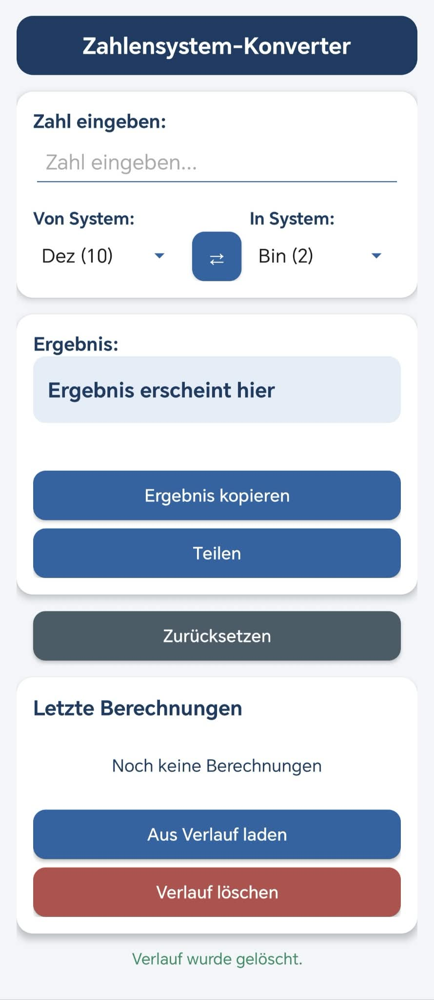
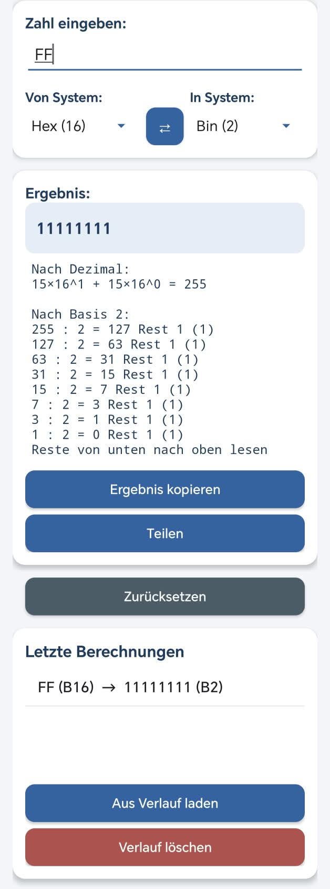
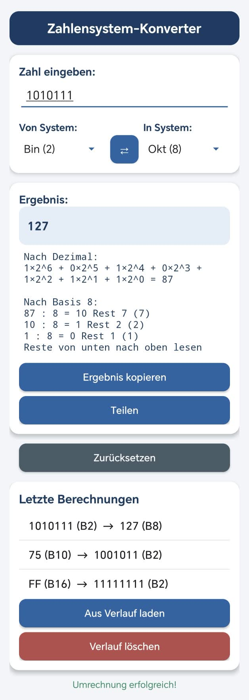

# BaseConvert

[English version](README.en.md)

BaseConvert ist eine Android-App, die Zahlen zwischen Dezimal-, Binär-, Oktal- und Hexadezimalsystem umrechnet und den Rechenweg Schritt für Schritt anzeigt. Sie richtet sich an Schüler und Studierende.

## Entstehung

Idee, Aufbau der Oberfläche, Entscheidungen zu den Funktionen und alle Tests stammen von mir. Den Code habe ich mit Unterstützung eines KI-Assistenten entwickelt und in Android Studio eingefügt, getestet und angepasst.

## Funktionen

- **Umrechnung in Echtzeit:** Das Ergebnis erscheint schon während der Eingabe. Dank BigInteger funktionieren auch sehr große Zahlen.
- **Rechenweg:** Die App zeigt die Zwischenschritte, also die Zerlegung nach Stellenwerten (nach Dezimal) und die wiederholte Division mit Rest (ins Zielsystem).
- **Eingabeprüfung:** Ungültige Ziffern für das gewählte System werden erkannt. Buchstaben von A bis F werden automatisch großgeschrieben.
- **Verlauf:** Mit der Eingabetaste wird eine Berechnung gespeichert. Der Verlauf bleibt nach dem Schließen der App erhalten, und ein Eintrag lässt sich wieder laden. Aufeinanderfolgende Duplikate werden vermieden.
- **Kopieren und Teilen:** Das Ergebnis lässt sich kopieren oder zusammen mit dem Rechenweg über andere Apps teilen, zum Beispiel in Word, Notizen oder Messengern.
- **Tauschen und Dunkelmodus:** Quell- und Zielsystem lassen sich mit einem Klick tauschen. Das Design passt sich dem hellen und dunklen Modus des Geräts an.

- ## Screenshots

  
  
  

## So funktioniert es

1. Die Eingabe wird geprüft: Nur Ziffern und Buchstaben, die im gewählten System gültig sind, werden akzeptiert.
2. Der Text wird mit BigInteger in einen Zahlenwert umgewandelt und dann im Zielsystem wieder ausgegeben.
3. Mit der Eingabetaste wird die Berechnung im Verlauf gespeichert, der auch nach dem Schließen der App erhalten bleibt.

## Technologien

- Java
- Android Studio
- XML-Layouts (Karten-Design mit abgerundeten Ecken)
- Standardklassen des Android SDK, ohne externe Bibliotheken

## Bekannte Einschränkungen

- Bei negativen Zahlen wird das Ergebnis berechnet, aber kein Rechenweg angezeigt.

## Geplant

- Export des Rechenwegs als PDF
- Mehrsprachige Oberfläche (Deutsch, Englisch, Arabisch)
- Abkürzungsmethode durch Gruppieren von Bits (Binär zu Oktal und Hexadezimal)

## Autor

Assem Al Sadi
